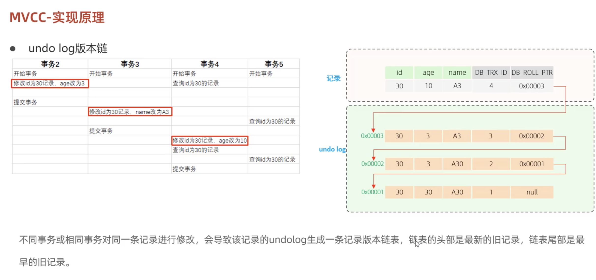

# MVCC

## 1. 基本概念

### 1.1 当前读

读取的是记录的最新版本。读取时还要保证其他并发事务不能修改当前记录，因此会对读取的记录进行加锁。

日常操作中的以下语句都属于当前读：

- `SELECT ... LOCK IN SHARE MODE`：加共享锁。
- `SELECT ... FOR UPDATE`：加排他锁。
- `UPDATE`、`INSERT`、`DELETE`：加排他锁。

### 1.2 快照读

简单的 `SELECT`（不加锁）就是快照读。快照读读取的是记录数据的可见版本，有可能是历史数据，不加锁，是非阻塞读。

不同事务隔离级别下，快照读的表现如下：

| 隔离级别 | 快照读的表现 |
| --- | --- |
| Read Committed（读已提交） | 每次快照读都会生成新的快照。 |
| Repeatable Read（可重复读） | 开启事务后，第一次快照读时建立快照，后续快照读复用该快照。 |
| Serializable（串行化） | 快照读会退化为当前读。 |

### 1.3 MVCC

MVCC 全称为 **Multi-Version Concurrency Control**，即**多版本并发控制**。

通过维护同一数据的多个版本，使读写操作能够并发进行，减少读写冲突。快照读为 MySQL 实现 MVCC 提供了非阻塞读功能。

MVCC 的具体实现主要依赖于：

- 数据库记录中的三个隐式字段。
- undo log 日志。
- ReadView（读视图）。

## 2. 记录中的隐藏字段

以如下记录为例：

| id | age | name |
| --- | --- | --- |
| 1 | 1 | tom |
| 3 | 3 | cat |

除表中定义的 `id`、`age`、`name` 外，记录中还包含用于 MVCC 的隐藏字段：

```text
id | age | name | DB_TRX_ID | DB_ROLL_PTR
```

| 隐藏字段 | 含义 |
| --- | --- |
| `DB_TRX_ID` | 最近修改事务 ID，记录插入这条记录或最后一次修改该记录的事务 ID。 |
| `DB_ROLL_PTR` | 回滚指针，配合 undo log 指向这条记录的上一个版本。 |
| `DB_ROW_ID` | 隐藏主键，如果表结构没有指定主键，将会生成该隐藏字段。 |

## 3. undo log

undo log 是回滚日志，在执行 `INSERT`、`UPDATE`、`DELETE` 时产生，用于数据回滚。

- 执行 `INSERT` 时产生的 undo log 只在回滚时需要，事务提交后可立即删除（为什么？）。
- 执行 `UPDATE`、`DELETE` 时产生的 undo log 不仅在回滚时需要，在快照读时也需要，因此不会立即删除。

### 3.1 undo log 版本链



流程：先把当前旧数据存放到 undo log 日志中，然后再 update 修改数据，最后再更新 DB_TRX_ID 和 DB_RPLL_PTR。

额外的：

​	1. 同一个事务中多次 update 操作，那么也会玩 undo log 日志中推送多个相同 DB_TRX_ID 的旧数据。

​	2. 那么在进行回滚和快照的时候是怎么知道这个事务应该执行多少个 undo log 日志的链表节点呢？依靠的是回滚段，每一个事务都会有属于自己的回滚段，里面记录了这个事务的所有操作，回滚和快照的时候会拿回滚段和 undo log 日志的每个链表节点进行比较，看这个链表节点属不属于这个事务，属于则消费链表节点进行回滚和快照，直到下一个链表节点不属于当前事务而停止。


## 4. ReadView（读视图）

ReadView（读视图）是**快照读** SQL 执行时 MVCC 提取数据的依据，记录并维护系统当前活跃的事务（未提交的）ID。

ReadView 中包含了四个核心字段：

| 字段 | 含义 |
| --- | :-- |
| `m_ids` | 当前活跃的事务 ID 集合。 |
| `min_trx_id` | 最小活跃事务 ID。 |
| `max_trx_id` | 预分配事务 ID，当前最大事务 ID + 1（因为事务 ID 是自增的）。 |
| `creator_trx_id` | ReadView 创建者的事务 ID。 |

### 4.1 版本链数据访问规则

截图中标注：`trx_id` 代表当前事务 ID。

以下按截图整理版本链数据的访问规则：

| 判断条件 | 是否可以访问该版本 | 说明 |
| --- | --- | --- |
| `trx_id == creator_trx_id` | 可以访问 | 说明数据是当前这个事务更改的。 |
| `trx_id < min_trx_id` | 可以访问 | 说明数据已经提交了。 |
| `trx_id > max_trx_id` | 不可以访问 | 说明该事务是在 ReadView 生成后才开启的。 |
| `min_trx_id <= trx_id <= max_trx_id`，且 `trx_id` 不在 `m_ids` 中 | 可以访问 | 说明数据已经提交。 |

> 理解与边界补充：这里参与比较的 `trx_id` 实际指正在判断的数据版本的修改事务 ID（该版本的 `DB_TRX_ID`），读取方事务的 ID 则由 `creator_trx_id` 表示。按照前文 `max_trx_id` 是“下一个待分配事务 ID”的定义，排除当前事务自身修改后，不可见条件应为 `trx_id >= max_trx_id`；需要检查 `m_ids` 的范围应为 `min_trx_id <= trx_id < max_trx_id`。在此范围内，若 `trx_id` 在 `m_ids` 中，则该版本不可见。参见 [MySQL 可见性判断源码](https://dev.mysql.com/doc/dev/mysql-server/8.4.10/read0types_8h_source.html)。

### 4.2 ReadView 的生成时机

不同的隔离级别，生成 ReadView 的时机不同：

| 隔离级别 | ReadView 的生成时机 |
| --- | --- |
| READ COMMITTED（读已提交） | 在事务中每一次执行快照读时生成 ReadView。 |
| REPEATABLE READ（可重复读） | 仅在事务中第一次执行快照读时生成 ReadView，后续复用该 ReadView。 |
