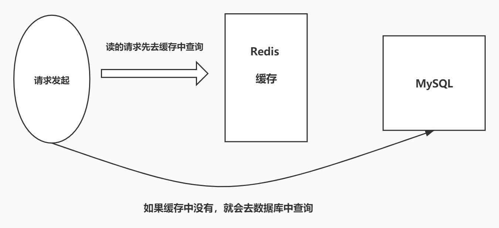
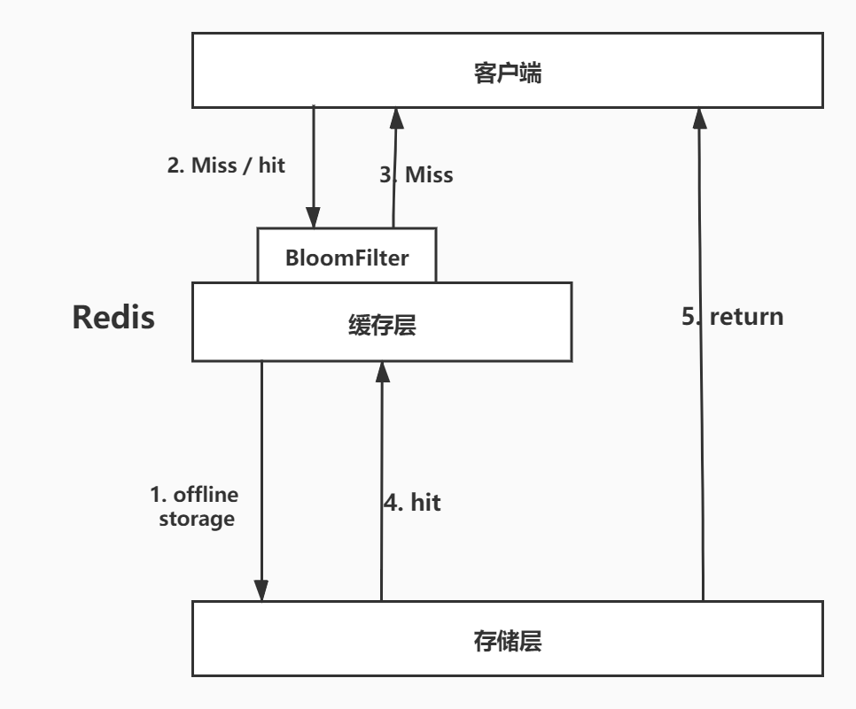
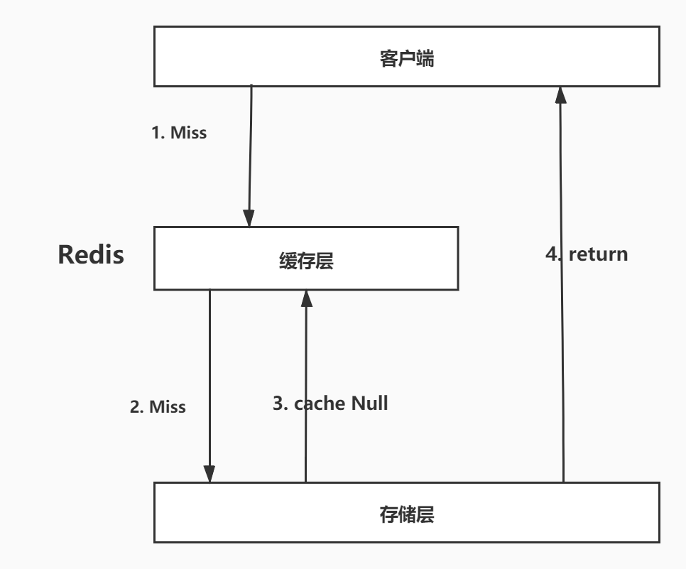
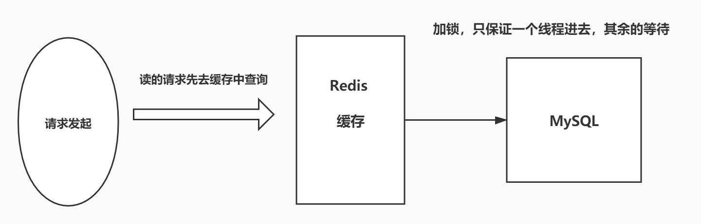
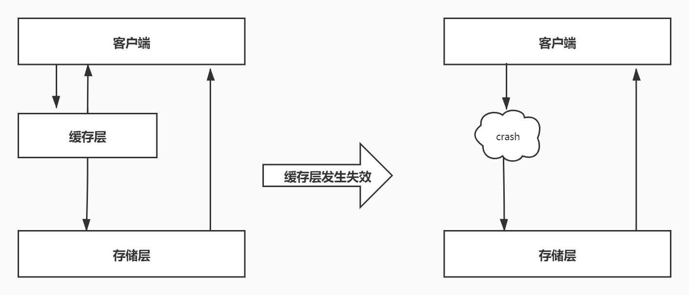

# 8. Redis面试题

## 8.1 什么是Redis？有什么特点

Redis 是一款开源，高性能的 key-value 的非关系型数据库。内存数据库
**特点**：
1）支持持久化，可以将内存中的数据持久化到磁盘，重启可以再次从磁盘中加载使用；
2）支持多种数据结构；
3）支持数据的备份：主从模式的备份；支持集群
4）高性能，读速度达 11 万次/秒，写速度达到 8.1 万次/秒
5）支持事务

## 8.2 说说 Redis 的数据类型 

一共 8 种
5 种基本数据类型：String、Hash、List、Set、Zset
3 种特殊类型：geospatial、hyperloglog、bitmap

## 8.3 Redis 和 Memcache 的区别？

1）Memcache 数据都存储在内存中，断电即失，数据不能超过内存大小；而 Redis 的数据可以持久化到硬盘。
2） Memcache 只支持简单的字符串，Redis 有丰富的数据结构；
3）底层实现方式不一样，Redis 自行构建了 VM 机制，速度更快。

## 8.4 Redis 是单线程的？

Redis 将数据放在内存中，单线程执行效率最高，多线程执行反而需要进行 CPU 上下文切换，这是个耗时操作，单线程效率最高。

## 8.5 说说 Redis的持久化

Redis 提供了两种持久化机制：RDB 和 AOF

RDB 持久化机制指的是，用数据集快照的方式记录 Redis 数据库的所有键值对，在某个时间点写入一个临时文件，持久化结束后，用这个临时文件替换上次持久化的文件，达到数据恢复的目的。
**优点**：
1）只有一个文件 dump.rdb 方便持久化；
2）容灾性好，一个文件可以保存到安全的磁盘；
3）性能最大化，Redis 会单独创建（fork）一个子进程进行持久化，主进程不进行任何 IO 操作，保证了性能；
4）在数据较多时，比 AOF 的启动效率高。
**缺点**：
最后一次持久化的数据可能会丢失。

AOF 持久化，是以独立日志的方式记录每次写命令，并在 Redis 重启时重新执行 AOF 文件中的命令以达到恢复数据的目的。AOF 主要解决数据持久化的实时性。
**优点**：
1）数据安全，配置 appendfsync 属性，可以选择不同的同步策略；
2）自动修复功能， redis-check-aof工具可以解决数据一致性问题；
**缺点**：
1）AOF 文件比 RDB 文件大，且恢复速度慢；
2）数据多时，效率低于 RDB。

AOF如何防止文件过大？AOF重写，只保留最后一次的修改记录。

## 8.6 Redis 的主从复制

主从复制值的是将一台 Redis 服务器的数据复制其他 Redis 服务器，前者称之为主节点，后者称之为从节点。

**主从复制的作用**：
1）数据冗余：主从复制实现了数据的热备份；
2）故障修复：当主节点出现故障后，从节点还可以提供服务，实现快速的故障修复。
3）负载均衡：在主从复制的基础上，配合读写分离，可以由主节点提供写操作，从节点提供读操作，实现负载均衡，提高并发量；
4）高可用的基石：主从复制是哨兵模式的基础。

**复制原理**：
从节点启动成功连接到主节点后，会发送一个 sync 的同步命令。主节点接收到命令之后，启动后台的存盘进程，收集所有修改数据库的命令，在后台执行完毕后将整个数据文件传送到从节点，完成一次完全同步。
**全量复制**：从节点在接收到了数据文件后，将其存盘文件加载都内存中；
**增量复制**：主节点继续将新收集到修改命令传递给从节点，完成同步

## 8.7 说说哨兵模式

哨兵模式是为了解决手动切换主节点的问题。Redis 提供了哨兵的命令，哨兵是一个**独立的进程**。哨兵能够后台监控主节点是否故障，如果故障需要将从节点选举为主节点。

其原理是哨兵通过发送命令，等待 Redis 服务器的响应，从而监控多个 Redis 节点。

当只有一个哨兵时，还是可能会出现问题的，比如哨兵自己挂掉。为此，可以使用多哨兵模式，多个哨兵之间相互监控。当主节点宕机了，哨兵1先检测到这个结果，系统并不会马上进行 failover 【故障转移】的过程。仅仅是哨兵1认为主节点不可用的现象称之为**主观下线**。当其余的哨兵也检测到主节点不可用之后，哨兵之间会进行一次投票选举从节点中的一个作为新的主节点，这个过程称之为**客观下线**。

**哨兵模式的优点**：
1）基于主从复制，高可用；
2）主从可以切换，进行故障转移，系统可用性好；
3）哨兵模式是主从模式的升级版，手动到自动，更加健壮。

**哨兵模式的缺点**：
1）不方便在线扩容；
2）实现哨兵模式需要很多的配置。

## 8.8 缓存穿透、缓存击穿和缓存雪崩

缓存穿透：

**概念**：用户需要查询一个数据，缓存中没有，也就是没有命中，于是向数据库中发起请求，发现也没有。当用户很多的时候，缓存都没有命中，于是都去请求数据库，这给数据库造成很大的压力。

**解决方案**：

- 布隆过滤器：是一种数据结构，对所有可能查询的参数以 hash 方式存储，先在控制层进行校验，不符合则丢弃，避免了过多访问数据库。
- 缓存空对象：当存储层没有命中时，即使返回空对象也将其缓存起来。（意味着更多的空间存储，即使设置了过期时间，缓存和数据库还是有段时间数据不一致。）

缓存击穿：

**概念**：当一个 key 非常热点时，在不断扛高并发，集中对这个热点数据进行访问，当这个 key 失效的瞬间，请求直接到达数据库，给数据库瞬间的高压力。

**解决方案**：

- 设置热点数据永不过期
- 加分布式锁：保证每个 key 同时只有一个线程去查询后端服务。

缓存雪崩：

**概念**：某个时间段，缓存集中失效

**解决方案**：

- 增加 Redis 集群的数量
- 缓存过期时间的时候，错峰设置
- 限流降级：在缓存失效后，通过加锁和队列来控制数据库写缓存的线程数量
- 数据预热：正式部署之前，将数据预先访问一遍，让缓存失效的时间尽量均匀

## 8.9 Redis 的使用场景

1）会话缓存：如 单点登录，使用 Redis 模拟 session，SSO 系统生成一个 token，将用户信息存到 Redis 中，并设置过期时间；
2）全页缓存
3）作为消息队列平台
4）排行榜和计数器
5）发布/订阅：比如聊天系统
6）热点数据：比如ES中搜索的热词

## 8.10 Redis 缓存如何保持一致性

读数据的时候首先去 Redis 中读取，没有读到再去 MySQL 中读取，读取到数据更新到 Redis 中作为下一次的缓存。

写数据的时候会产生数据不一致的问题。无论是先写入 Redis 再写入 MySQL 中，还是先写入 MySQL 再写入 Redis 中，这两步操作**都不能保证原子性**，所以会出现 Redis 和 MySQL 中数据不一致的问题。

**无论采取何种方式都不能保证强一致性**，如果对 Redis 中的数据设置了**过期时间，能够保证最终一致性**，对架构的优化只能降低发生的概率，不能从根本上避免不一致性。

更新缓存的两种方式：删除失效缓存、更新缓存
更新缓存和数据库有两种顺序：先数据库后缓存、先缓存后数据库
两两组合，分为四种更新策略。

## 8.11 集群

redis cluster 分为 16384个槽，最多可支持1000个节点，数据存放时，根据CRC16(key)%16384取模，得到对应的槽，存放到槽对应的节点上。

取数据时，会计算槽，进行请求重定向，如果在当前节点，直接返回数据，不在move到对应节点，获取数据

# 7. Redis的缓存穿透、缓存击穿和缓存雪崩

## 7.1 Redis可能的问题

Redis 缓存的使用，极大的提升了应用程序的性能和效率，特别是数据查询方面。但同时，它也带了一些问题。其中，最要害的是问题，就是数据一致性的问题，从严格意义上讲，这个问题无解。如果对数据的一致性要求很高，那么久不能使用缓存。

另外一些典型的问题就是，缓存穿透、缓存雪崩缓存击穿，目前，是业界也都有比较流行的解决方案。

## 7.2 缓存穿透（查不到数据导致）

缓存穿透的概念简单，用户想要查询一个数据，发现 Redis 内存数据库没有，也就是缓存没有命中。于是向持久层数据库查询。发现也没有，于是本次查询失败。当用户很多的时候，缓存都没有命中，于是都去请求了持久层数据库。这给持久层数据库造成很大的压力，这时候就相当于出现了缓存穿透。

> 解决方案：布隆过滤器

### 7.2.1 布隆过滤器

布隆过滤器是一种数据结构，对所有可能查询的参数以 hash 形式存储，在控制层先进行校验，不符合则丢弃，从而避免了对底层存储系统的查询压力。

### 7.2.2 缓存空对象

当存储层不命中后，即使返回的空对象也将其缓存起来，同步会同步一个过期时间，之后再访问这个数据将会从存储中获取，保护了后端数据源。

但是这种方法会存在两个问题：

1、如果控制能够被缓存起来，这就意味着缓存需要更多的空间存储，因为这当中可能会有很多的空值的键；

2、即使对空值设置了过期时间，还是会存在缓存层和存储层的数据会有一段时间窗口的不一致，这对于需要保持一致性的业务会有影响。

## 7.3 缓存击穿（请求太多，缓存过期）

这里需要注意和缓存穿透的区别。缓存击穿，是指一个 key 非常热点，在不停的扛着大并发，大并发集中对这一个点进行访问，当这个 key 在失效的瞬间，持续的大并发就穿破缓存，直接请求数据库，就像在一个屏障上凿开了一个洞。

当某个 key 在过期的瞬间，有大量的请求并发访问，这类数据一般是热点数据，由于缓存过期，会同时访问数据库来查询最新的数据，并回写缓存，会导致数据库瞬间压力过大。

> 解决方案：

### 7.3.1 设置热点数据永不过期

从缓存层来看，没有设置过期时间，所以不会出现热点 key 过期后产生的问题。

### 7.3.2 加互斥锁

分布式锁：使用分布式锁，保证对于每个 key 同时只有一个线程去查询后端服务，其他线程没有获得分布式锁的权限，因此只需要等待即可。这种方式将高并发的压力转移到了分布式锁，因对分布式锁的考验很大。

### 

## 7.4 缓存雪崩

缓存雪崩，是指在某一个时间段，缓存集中过期失效。

产生雪崩的原因之一，比如马上就要双十二零点，，很快就会有一波抢购，这波商品时间比较集中的放在了缓存，假设缓存一个小时。那么到了凌晨一点钟的时候，这批商品的缓存就都会过期了。而对这批商品的访问查询，都落到数据库上，对于数据库而言，就会产生周期性的压力波峰。于是所有的请求都会到达存储层，存储层的调用量会暴增，造成存储层也回掉的情况。

其实集中时期，倒不是非常致命，比较致命的缓存雪崩，是缓存服务器某个节点宕机或者断网。因为自然形成 的缓存雪崩，一定是某个时间段中创建缓存，这个时候也是可以顶住压力的。无非就是对数据库产生周期性的压力而已。而缓存服务节点的宕机，对于数据库服务器的压力是不可预的，很有可能瞬间就把数据库压垮。

> 解决方案

### 7.4.1 Redis 高可用

这个思想的含义是，既然 redis 有可能挂掉，那我多增设几台 redis，这样一台挂掉之后其他的还可以继续工作，其实就是搭建的集群

### 7.4.2 限流降级

这个解决方案的思想是，在缓存失效后，通过加锁或者队列来控制数据库写缓存的线程数量。比如对某个 key 只允许一个线程查询数据和写缓存，其他线程等待。

### 7.4.3 数据预热

数据预热的含义是在正式部署之前，把可能的数据线预先访问一遍，这样部分可能大量访问的数据就会加载到缓存。在即将发生大并发访问前手动触发加载缓存不同的key，设置不同的过期时间，让缓存失效的时间点尽量均匀。